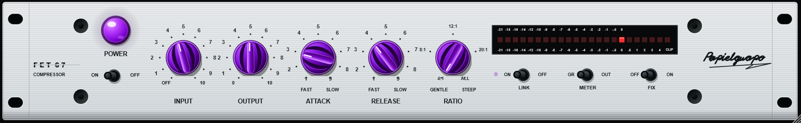

# PAPIELGUAPO - 1167 Compressor

**Fabricante: papielguapo · 1.2.4 Clean + Sidechain · Windows x64**



Compresor FET mono/estéreo, C++17/JUCE 9.0.5, VST3 y Standalone. Detector de realimentación, recuperación dependiente del programa y coloración asimétrica. Es un modelo original comparado con CLA-76 Bluey; no se ha demostrado equivalencia 1:1 ni preferencia en escucha ciega.

## Selección segura del detector en 1.2.4

El parámetro **External Sidechain** del host está apagado por defecto. Activar un bus auxiliar por sí solo ya no sustituye el detector interno por una entrada silenciosa. Esto evita perder la compresión y saturar la salida al subir INPUT en hosts que habilitan buses auxiliares sin enviarles audio. No se añade ningún control a la skin.

Para usar sidechain externo: enruta el key al bus **Sidechain** y activa **External Sidechain** en los parámetros del host. Para volver al detector interno, apaga ese parámetro. Si el bus está deshabilitado se usa el detector interno. Con selección externa y bus activo, un key silencioso sí libera la compresión, como corresponde al ducking.

Los proyectos anteriores recuperan External Sidechain apagado; si utilizaban ruteo externo, deben activarlo explícitamente y guardar el proyecto. Se mantienen los IDs anteriores y se añade el nuevo parámetro al final. [Pruebas y procedencia](Validation/Detector-1.2.4/RESULTADOS.md).

## Entrada numérica de 1.2.3

Doble clic sobre INPUT, OUTPUT, ATTACK, RELEASE o RATIO abre un campo temporal sobre el mando. **Enter** aplica; **Escape** o perder el foco cancela. No se añaden elementos permanentes a la skin. Admite coma o punto decimal y limita valores numéricos al rango del mando. INPUT acepta también `OFF`; RATIO acepta `4`, `8`, `12`, `20`, `ALL` o las formas `4:1`, `8:1`, etc. Texto inválido conserva el valor anterior y marca el campo en rojo. El cambio se comunica al host como un gesto de automatización.

INPUT/OUTPUT usan 0–10 y ATTACK/RELEASE 1–9, como los números de la skin; el campo no interpreta unidades de tiempo. El doble clic deja de restaurar el valor inicial. [Pruebas de la revisión](Validation/ValueEntry-1.2.3/RESULTADOS.md).

## Sidechain externo de 1.2.2

Bus de entrada **Sidechain** opcional mono/estéreo, apagado por defecto y controlado por el DAW. No hay botones nuevos ni cambios en la skin. En 1.2.4 el detector externo requiere activar también **External Sidechain** desde los parámetros del host. Su audio dispara la compresión del audio principal sin mezclarse con él; un key externo seleccionado y silencioso no vuelve automáticamente al detector interno. INPUT también ajusta la sensibilidad del detector externo; la ganancia virtual de realimentación conserva la calibración del controlador.

El SC FILTER existente aplica sus 80 Hz también al detector externo. El enlace estéreo se conserva; una entrada principal mono reacciona al mayor nivel de los dos canales del key estéreo. La entrada externa se sobremuestrea a 8× con el mismo filtro de subida que la principal. No cambia la latencia declarada.

En **FL Studio**, crea el envío «Sidechain to this track» desde la pista que dispara hacia la que contiene FET 67. En el wrapper del plugin, abre **Processing → Connections**, habilita/asigna la entrada auxiliar **Sidechain** a ese envío. La selección de fuente se hace en el host. [Manual oficial del wrapper](https://www.image-line.com/fl-studio-learning/fl-studio-online-manual/html/plugins/wrapper.htm). El procedimiento está documentado, pero no se ha validado mediante control de FL en este equipo.

Pruebas y procedencia de 1.2.2: [Validation/Sidechain-1.2.2/RESULTADOS.md](Validation/Sidechain-1.2.2/RESULTADOS.md).

## Base de 1.2.1 Clean

Menos saturación al subir INPUT: se reduce la no linealidad de entrada y la coloración par/impar de la etapa FET. La saturación de seguridad de salida empieza ahora en 0 dBFS en lugar de −4 dBFS; no es un limitador de picos. Conserva los controles, ratios, tiempos, SC FILTER y FIX. Puede superar 0 dBFS: ajusta OUTPUT para dejar margen.

Los proyectos anteriores mantienen sus parámetros pero cambian de sonido con esta revisión. El informe de esta versión se encuentra en [Validation/Clean-1.2.1/RESULTADOS.md](Validation/Clean-1.2.1/RESULTADOS.md). Los registros de 1.2.0 se conservan como historial.

## Base de 1.2

- Sobremuestreo FIR **8×**, con filtros y tiempos recalculados a la frecuencia interna.
- **65 samples de latencia** declarados al host y compensados también en la ruta seca: unos 1,35 ms a 48 kHz.
- La revisión 1.2.0 aumentó el armónico par respecto a 1.1; **1.2.1 lo reduce** para ofrecer una respuesta más limpia. Las mediciones antiguas de color no describen esta revisión.
- Detector y filtros continuos durante bypass; desaparece el reinicio que provocaba el pico al volver a activar.
- RMS independiente por canal, seguido de selección del mayor.
- Estado compatible con automatización fraccionaria de interruptores y con proyectos anteriores.
- Procesamiento por fragmentos de capacidad fija, preparado fuera del callback.

El DSP cambia el sonido de sesiones anteriores. Se mantienen fabricante `Papi`, código `Ft67` y los IDs antiguos. El parámetro `bypass` continúa para el DAW y para proyectos antiguos; su botón se ha sustituido por **FIX**. POWER permanece junto al piloto violeta. **SC FILTER** ocupa el antiguo hueco de LINK; los proyectos nuevos siguen enlazados en estéreo y el parámetro LINK antiguo se conserva para automatización y sesiones previas.

## SC FILTER

Apagado por defecto. Al activarlo, un paso alto de **80 Hz / primer orden** actúa únicamente sobre la señal del detector. Reduce la influencia de graves, proximidad y golpes de aire sobre la compresión; no recorta directamente el grave de la ruta de audio. El cambio se interpola durante 20 ms y el filtro mantiene su historia mientras está apagado. No es un de-esser ni elimina los golpes de aire de la grabación.

En el ensayo de tono a 40 Hz, GR pasa de 8,18 a 3,15 dB; a 1 kHz pasa de 8,889 a 8,863 dB. Con compresión inactiva, la salida ON/OFF coincide exactamente. Son medidas de esos ajustes, no una garantía de cuántos dB cambiará cualquier voz. KI no se ha añadido.

## FIX: comparar niveles

**FIX está apagado por defecto: ON a la izquierda y OFF a la derecha.** Actívalo para aproximar el RMS de salida al RMS de la señal original de entrada, antes del mando INPUT. Usa un ajuste común para ambos canales, después del compresor, sin modificar su detector.

La estimación RMS usa 750 ms y la ganancia se mueve suavemente durante aproximadamente 1 s; deja varios segundos para estabilizar. El margen está limitado a ±24 dB y el aprendizaje se mantiene durante el silencio. No puede recuperar una entrada silenciada ni garantiza igualdad de sonoridad LUFS o percepción. Tampoco limita picos: deja margen en tu DAW. Cuando POWER está en OFF o el DAW hace bypass, FIX no aplica ganancia a la ruta seca.

Con FIX apagado, INPUT y OUTPUT son completamente manuales y no hay autogain. Los cambios de activación tienen fundidos de 20 ms.

## Controles

| Control | Rango y uso |
|---|---|
| INPUT | 0 = OFF; 0,1–10 equivale a −24…+30 dB |
| OUTPUT | −24…+24 dB; posición 5 = 0 dB |
| ATTACK | 1 = 20 µs, 9 = 800 µs: **1 rápido, 9 lento** |
| RELEASE | 1 = 50 ms, 9 = 1100 ms; recuperación dependiente del programa |
| RATIO | 4:1, 8:1, 12:1, 20:1 y ALL nominal 24:1 |
| ALL | Ataque de 450 µs, lag del detector y recuperación modificada |
| SC FILTER | Paso alto de 80 Hz solo en el detector; OFF por defecto |
| METER | GR o RMS OUT; 0 OUT = −18 dBFS RMS |

Los tiempos son constantes del modelo, no tiempos efectivos certificados frente al hardware. CLIP es un escalón de la escala y no un medidor de true peak. La saturación suave no es un limitador brickwall. El bypass asentado conserva los samples secos exactamente, desplazados los 65 samples declarados.

La interfaz es vectorial: 1634×252, escala 50–250 %, tamaño guardado. Doble clic en un knob permite escribir su valor.

## Punto de partida para voz

Ratio 4:1, Attack 7–9, Release 4, Output 5. Sube Input hasta obtener aproximadamente 3–6 dB de GR en las partes fuertes. Compara con FIX o iguala OUTPUT manualmente. Baja Attack hacia 1 para sujetar más los picos; súbelo hacia 9 para preservar más el inicio de palabras. La numeración no se traslada directamente desde Waves.

Se preparó un A/B educativo privado con la voz de Al James, Schoolboy Fascination, de Cambridge-MT. Los renders y las pistas no se distribuyen en este repositorio. Su uso no constituye autorización para una demo comercial ni una aprobación auditiva.

## Instalar

Descarga el [ZIP de 1.2.4 RC1](https://github.com/papielguapo/PAPIELGUAPO-1167-Compressor/releases/tag/v1.2.4-rc1) y copia la carpeta completa `Binaries/PAPIELGUAPO - 1167 Compressor.vst3` a `C:\Program Files\Common Files\VST3`. Puede requerir permisos de administrador. Cierra instancias cargadas antes de actualizar, reescanea plugins y busca **FET 67 / Papielguapo**. También se entrega Standalone. No se incluye instalador ni firma Authenticode.

## Compilar y validar

Visual Studio 2022 con C++ de escritorio, Windows SDK y CMake 3.22+:

```powershell
cmake -S . -B build -G "Visual Studio 17 2022" -A x64 -DFET67_COPY_PLUGIN_AFTER_BUILD=OFF -DFET67_BUILD_TESTS=ON
cmake --build build --config Release --parallel 2
ctest --test-dir build -C Release --output-on-failure
```

CMake usa `C:/JUCE` si contiene JUCE 7/8/9; en su ausencia descarga JUCE 9.0.5 oficial. Otra copia local: `-DFET67_JUCE_PATH="D:/SDK/JUCE"`. Los binarios están en `build/FET67_artefacts/Release`; las pruebas en `build/FET67Tests_artefacts/Release/FET67Validation.exe`. La copia automática está activada por defecto; el ejemplo la desactiva para no escribir en Program Files durante el build.

El workflow Windows validation compila con Visual Studio 2022, ejecuta CTest y pluginval oficial 1.0.4 nivel 10, y conserva artefactos. Consulta [Validation/STATUS.md](Validation/STATUS.md) y sus logs para distinguir lo comprobado de lo pendiente. Los datos de `Reference/` son históricos de 1.1, no una calibración de 1.2.

El [run independiente 43745547299](https://github.com/papielguapo/PAPIELGUAPO-1167-Compressor/actions/runs/43745547299) validó la revisión histórica 1.2.0. La procedencia y las mediciones de 1.2.1 se registran en [su informe](Validation/Clean-1.2.1/RESULTADOS.md). Los binarios dependen del runtime de Microsoft Visual C++ x64 y de componentes de Windows.

La aprobación auditiva, la prueba en FL Studio, otros hosts, el validador independiente de Steinberg y los requisitos de distribución deben registrarse por separado. No se declara validación comercial completa.
